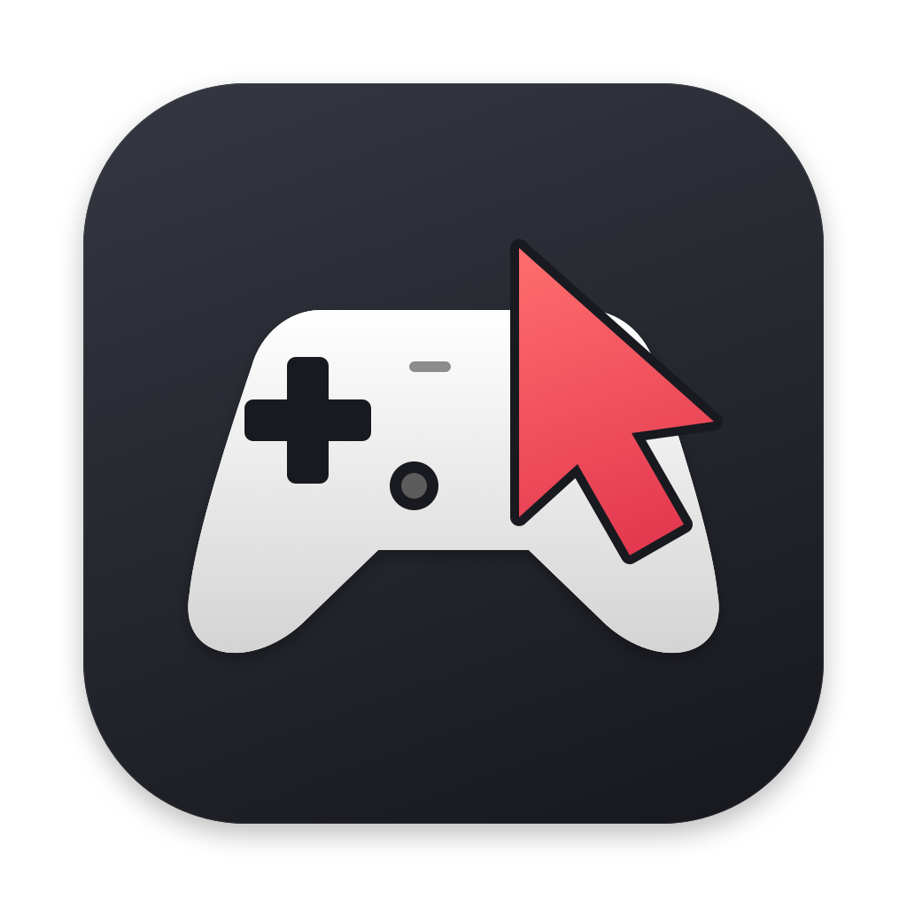
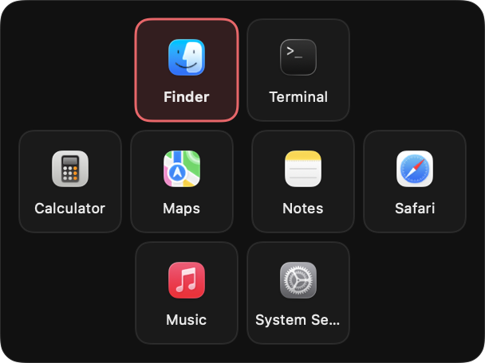
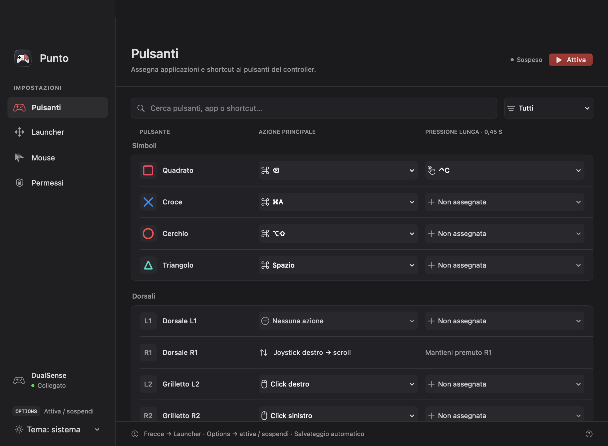
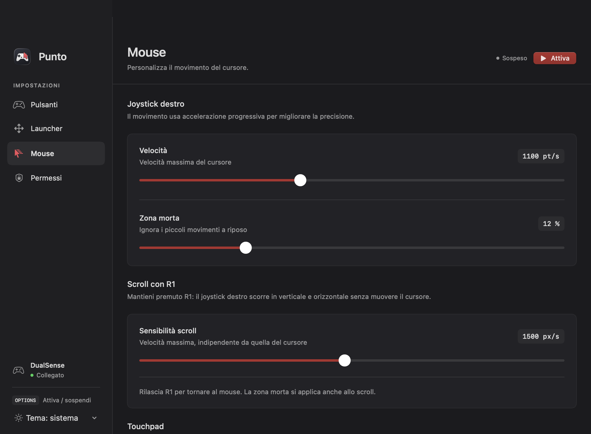
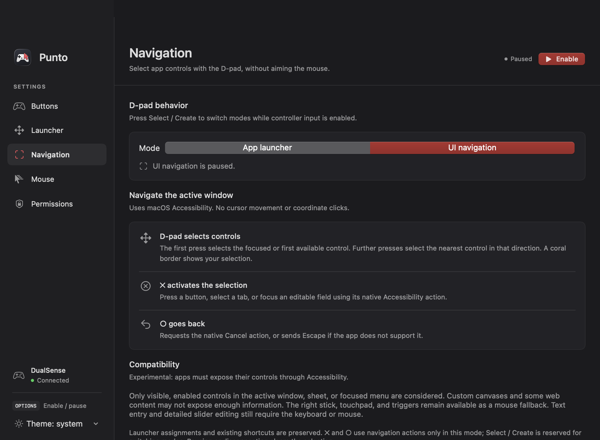
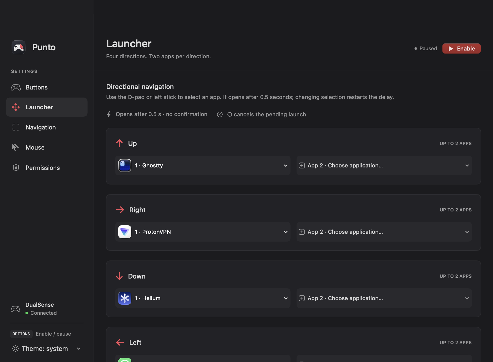

<p align="center">
  
</p>

<h1 align="center">Punto</h1>

<p align="center">
  Your Mac. Your controller.<br>
  Mouse control, UI navigation, shortcuts, and an app launcher for the PS5 DualSense.
</p>

<p align="center">
  
  
  
  
</p>

<p align="center">
  <a href="#features">Features</a> ·
  <a href="#screenshots">Screenshots</a> ·
  <a href="#getting-started">Getting started</a> ·
  <a href="docs/DEVELOPMENT.md">Development</a>
</p>

---

## Features

| | What it does |
| :--- | :--- |
| **Mouse control** | Move the cursor with the right stick or the controller’s touchpad. |
| **Scrolling** | Hold R1 and move the right stick. Scroll sensitivity is adjustable. |
| **Custom shortcuts** | Record your own combination, including modifier-only chords such as ⌥⇧. |
| **Push-to-talk** | Keep the shortcut pressed for as long as you hold the controller button. |
| **Long press** | Assign a second shortcut to the same button. |
| **Directional launcher** | Four directions, up to two apps per direction. Launch instantly. |
| **UI navigation** | Select controls in the active app with the D-pad or left stick and activate them with ✕. No mouse aiming. |

A **native SwiftUI interface**, dark/light/system themes, and automatically saved preferences. The app requires no server, account, or web service.

## Screenshots

### An app launcher that feels like a HUD

Press a direction to open the app immediately. A compact **304 × 228-point** overlay shows only the app tiles, with a coral border around your selection. Press the same direction again while it is visible to switch to the second app. It disappears after **1.2 seconds**—no confirmation button required.

<p align="center">
  
</p>

<p align="center"><sub>Actual overlay with demo applications. No apps are assigned by default.</sub></p>

### Your buttons, your actions

Recorded shortcuts, apps to bring to the foreground, and a separate assignment for long presses.

<p align="center">
  
</p>

<details>
<summary><strong>Mouse settings, UI navigation, and launcher configuration</strong></summary>

### Mouse and scrolling

Adjust cursor speed, stick deadzone, and scroll sensitivity. Scroll speed is independent of cursor speed.



### Navigate apps like a game menu

Choose **Navigation → UI navigation**, or press **Select / Create** (the small button to the left of the touchpad) while input is enabled. The D-pad or left stick moves a coral selection border between accessible controls; **✕ activates** and **○ goes back**. Hold the left stick to keep navigating; in the launcher, each tilt opens an app only once. Press Select / Create again to restore the launcher.

This feature is **experimental** and uses the app’s native macOS Accessibility elements—not simulated coordinate clicks. Custom canvases and some web content may not expose usable controls. Mouse control remains available as a fallback; text entry still needs a keyboard.



### Your apps in four directions

Choose up to **eight applications**, arranged across up, right, down, and left.



</details>

## Controls

| Controller input | Action |
| :--- | :--- |
| Right stick | Move the cursor |
| **Left stick** | Navigate controls or launch apps; hold to repeat in UI navigation |
| Touchpad | Move the cursor with one finger |
| **Select / Create** | Switch between the launcher and UI navigation |
| **R1 + right stick** | Scroll vertically and horizontally |
| **R2** | Left click; hold to drag |
| **L2** | Right click; hold to drag |
| **↑ → ↓ ←** | Launcher: open an app. UI navigation: select a control. |
| **✕ / ○ in UI navigation** | Activate the selection / go back |
| **○ while the overlay is visible** | Dismiss the visual feedback |
| **Options** | Enable or pause controller input |
| Other buttons | Custom shortcuts or application actions |

> **Long presses:** without a Hold assignment, a shortcut starts immediately and stays pressed until release. With Hold assigned, a quick tap runs the primary action on release; after **0.45 seconds**, only the long-press shortcut is activated.

## Getting started

### Requirements

- **macOS 12+** and a standard DualSense, connected through USB or Bluetooth.
- **Apple Command Line Tools**, including Swift and the macOS SDK. Full Xcode is not required.
- A local code-signing certificate: see [build signing setup](docs/DEVELOPMENT.md#local-code-signing).

### Build and run

```sh
git clone git@github.com:guglielmobartelloni/Punto.git
cd Punto
make
open build/Punto.app
```

This repository is private. Cloning requires an authorized GitHub account.

### First-time setup

1. Connect the controller. For Bluetooth pairing, hold **PS + Create** until the light flashes, then pair it in macOS settings.
2. In Punto, open **Permissions → Open Accessibility settings** and grant Accessibility permission. Also grant Input Monitoring if macOS requests it.
3. Configure **Buttons**, **Launcher**, **Navigation**, and **Mouse**, then click **Enable**.

Punto always starts paused. Closing settings leaves it running in the menu bar. It appears in the Dock only while the configuration window is open.

## Good to know

- This is an **in-development** build, not yet distributed with Developer ID signing and notarization.
- It supports **one controller at a time** and the standard DualSense, not the DualSense Edge.
- R1, Options, the D-pad, and Select / Create have reserved roles. Touchpad click is customizable. In UI navigation, ✕ and ○ temporarily replace their normal shortcuts. Saved assignments are preserved.
- Some macOS-reserved combinations may not be recordable or reproducible.
- The bundle and executable are named **Punto.app** and **Punto**. The original bundle identifier and signing identity are retained to preserve preferences and signing continuity.
- If upgrading from the old bundle path, macOS may require you to add Punto again under Accessibility.

## Development

```sh
make test                 # Input, shortcuts, scrolling, and directional selection
make test-dock            # Window and Dock lifecycle
make test-launcher-ui     # Overlay routing and a preview with demo apps
make test-navigation-ui   # UI navigation routing and safe mode switching
```

The UI tests require a macOS graphical session. They do not launch demo applications or change saved assignments. An optional live Accessibility fixture test is described in the development guide.

→ [Architecture, local signing, and manual verification](docs/DEVELOPMENT.md)
